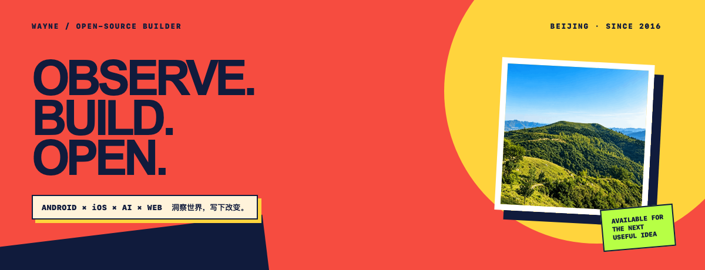

  

  
  
  

## Hi, I'm Wayne 👋

I turn observations into useful, open tools.

I'm a mobile engineer and long-term open-source curator based in Beijing. I build across **Android, iOS, AI and the Web**, with a bias toward practical workflows, maintainable systems and work that other developers can reuse.

- 🔭 Currently improving developer workflows and open-source discovery.
- 🧭 GitHub member since 2016.
- 🌱 Building a bilingual digital garden at [waynez01.github.io](https://waynez01.github.io/).
- 💬 Interested in mobile engineering, AI-native products, developer tools and product experience.

<strong>中文简介</strong>

 
我是一名来自北京的移动开发者与开源维护者，关注 Android、iOS、AI 与 Web。喜欢从真实问题出发，把复杂流程整理成可维护、可复用、可持续更新的工具与知识。

## Focus

| Android | iOS | AI | Web |
| :--- | :--- | :--- | :--- |
| Kotlin · Compose · Architecture | Swift · SwiftUI · Native UX | Agents · Automation · AI-native products | TypeScript · Product Web · Open Source |

## Selected work

| Project | What it does |
| :--- | :--- |
| [**Android_open_project**](https://github.com/WayneZ01/Android_open_project) | A maintained and validated Android open-source discovery index with 999 links across 88 categories. |
| [**bundle-desk**](https://github.com/WayneZ01/bundle-desk) | A local Android AAB → APKS workstation for signing, device installation, launching and app-information parsing on macOS and Windows. |
| [**WayneZ01.github.io**](https://github.com/WayneZ01/WayneZ01.github.io) | My bilingual digital garden and project portfolio across Android, iOS, AI and the Web. |

## GitHub signals

  
  
  

## Find me

- [Personal site](https://waynez01.github.io/)
- [GitHub repositories](https://github.com/WayneZ01?tab=repositories)
- [CSDN writing](https://blog.csdn.net/zhanwei0102)
- [GitHub Gists](https://gist.github.com/WayneZ01)

Observe the world. Then write a little change. / 洞察世界，然后写下一点改变。

